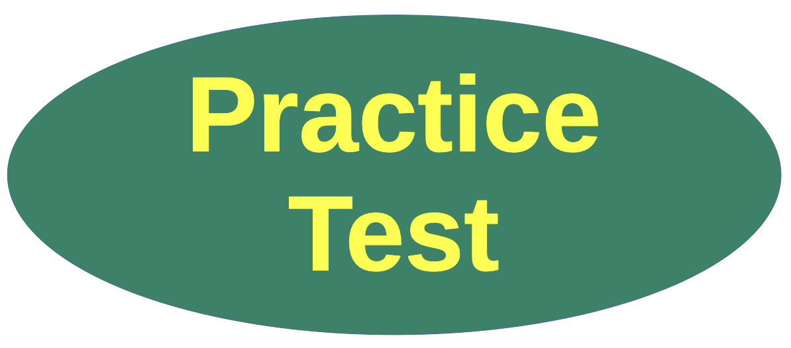

# Data Science (CS301) 

Lab 04: Midterm Preparation

## Study Guide Assignment

## Assigned and Due

* __Assigned__:  Thursday 15th October 2026 at 2:30pm

* __Due and Expiration__: Thursday 22nd October 2026 at 11:59pm

Note: the _expiration_ date is the last date you can submit your work for a grade.

Some elements of this lab were written or corrected by Claud.

**Midterm Exam** : Thursday 22nd October 2026, during lab



In this assignment, you will work through a practice exam written in the style of the CS301 midterm. The study guide has the same structure as the real exam but uses different data, so memorizing answers will not help. The goal is to practice the *skills*.

## Important Details

* The study guide is due in one week, on **Thursday 22nd October 2026**.
* You do not have to report back on your score for the study guide.
* The midterm will be held during lab on **Thursday 22nd October 2026**.
* You are given up to **two hours** to complete the midterm.
* The real midterm has 42 questions: 30 multiple choice (Part I), 6 matching (Part II) and 6 True/False (Part III). The study guide has the same structure.

You will correct your own work using the answer key and justifications at the back of the study guide.

Note: **Do not look at the solutions right away.** Give yourself real time to work through the questions first. Studying is far more effective when you struggle with a question before you check it. Time yourself, and only open the answer key once you have committed to an answer for every question.


## Topics Covered

* R basics and vectors (recycling, indexing)
* Matrices, lists and data frames
* `dplyr` verbs and pipes (`filter`, `mutate`, `arrange`, `select`, `group_by`, `summarize`)
* Logical operators and missing values
* `ggplot2` basics and common errors
* Scatter plots, line plots, box plots, histograms, heatmaps and correlation
* Reading plots and tables to describe trends; `plotly` interactivity
* Normal and binomial `d/p/q/r` functions
* Sampling distributions, standard error and the Central Limit Theorem

Confidence intervals are *not* on this exam.


## Repository Contents

* `docs/study_guide.html` : the study guide with graphics (download it and open it in your browser)
* `docs/study_guide.qmd` : the Quarto source of the study guide
* `writing/reflection.md` : the reflection you will complete
* `config/gatorgrade.yml` : the checks used by GatorGrade

## Assignment Deliverables and What To Do

1. Open the study guide and work through all 42 questions, timing yourself (up to two hours).
2. Check your answers using the answer key and justifications at the back of the study guide. Mark the questions you missed.
3. Review the topics behind the questions you missed.
4. Complete the questions in `writing/reflection.md`. Replace every `TODO` and remove the `Add Your Name Here` prompt.

### Submitting Assignments

Submit your work by pushing your changes to your GitHub repository. Commit and push regularly while you work. The commands are the following.

``` bash
git add -A
git commit -m "Your notes about commit here" 
git push
```


## Project Assessment

The grade that a student receives on this assignment will have the following components.

* **GitHub Actions CI Build Status [up to 5%]:**: For the lab repository associated with this assignment students will receive a checkmark grade if their last before-the-deadline build passes. This is only checking some baseline writing and commit requirements as well as correct running of the program. An additional reduction will given if the commit log shows a cluster of commits at the end clearly used just to pass this requirement. An addition reduction will also be given if there is no commit during lab work times. All other requirements are evaluated manually.

* **Mastery of Technical Writing [up to 95%]:**: Students will also receive a checkmark grade when the responses to the writing questions presented in the `reflection.md` reveal a proficiency of both writing skills and technical knowledge. To receive a checkmark grade, the submitted writing should have correct spelling, grammar, and punctuation in addition to following the rules of Markdown and providing conceptually and technically accurate answers.

### Checks for GatorGrade

For immediate feedback, we use GatorGrade to report missing components. You will see a red X that turns into a green check mark when all components are included. Click on the red X to see a listing of the components to address.

You can also run it locally (install with `pipx install gatorgrade`):

`gatorgrade --config config/gatorgrade.yml`


## Seeking Assistance

* Extra resources for using markdown include;
  + [Markdown Tidbits](https://www.youtube.com/watch?v=cdJEUAy5IyA)
  + [Markdown Cheatsheet](https://github.com/adam-p/markdown-here/wiki/Markdown-Cheatsheet)

If you have questions, please ask the Technical Leaders or the instructor.
